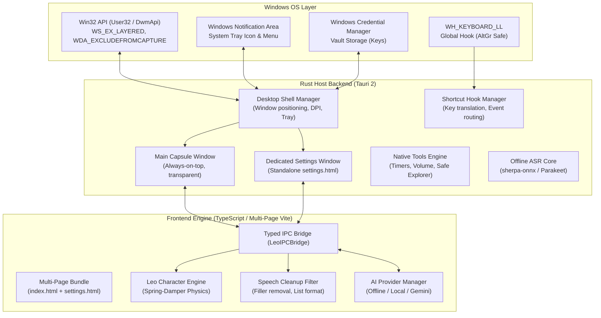

# System Architecture Document: Leo

**Document ID:** `ARCH-LEO-001`  
**Version:** `1.1.0` (Status: Approved)  
**Target Platform:** Windows 10 & 11 (64-bit AMD64)  
**Framework:** Tauri 2 (Rust Backend + TypeScript / Multi-Page Vite Frontend)  

---

## 1. High-Level System Architecture

Leo utilizes a hybrid **Tauri 2 (Rust) + TypeScript/Vite** architecture. Native operating system primitives (window transparency, low-level keyboard hooks, Win32 Named Pipes, and process spawning) reside in the Rust backend, while the user interface, animation physics, and local model streaming reside in the frontend webview.

---

## 2. Core Subsystems and Module Boundaries

### 2.1 Multi-Page Webview Architecture (`app/vite.config.ts`)
- **Main Capsule Overlay (`index.html`):** A frameless, transparent capsule floating at the top edge of the primary monitor. Renders the procedural 2D canvas face, audio meter, dictation drawer (400×300), and chat drawer (400×340).
- **Dedicated Settings Window (`settings.html`):** A standalone 560×640 window for configuring Gemini API keys (masked input), testing connections, detecting local Ollama/LM Studio endpoints, adjusting voice parameters, and managing privacy settings.
- **Vite Multi-Page Bundling:** Both pages are bundled into `dist/` and statically embedded into the binary (`frontendDist: "../dist"`). Leo never requires localhost dev servers in production.

### 2.2 Native Desktop Shell & System Tray (`app/src-tauri/src/lib.rs`)
- **Transparent Layering:** Window uses Win32 `WS_EX_LAYERED` and `SWP_FRAMECHANGED` to guarantee true transparent pixels outside the capsule.
- **Screen Share Protection:** Window applies `SetWindowDisplayAffinity(hwnd, WDA_EXCLUDEFROMCAPTURE)` to prevent accidental broadcast during conference calls.
- **System Tray Lifecycle:** Configures notification area icon with menu items (`Open Leo`, `Show/Hide Dock`, `Settings`, `Start with Windows`, `Quit`). Closing the dock intercepts `WindowEvent::CloseRequested` to hide to tray rather than exiting.

### 2.3 AI Provider Architecture (`src/models/`)
- **Strict Offline Mode:** Completely disables cloud network requests.
- **Local Loopback Providers:** Discovers and connects to OpenAI-compatible endpoints (`http://127.0.0.1:11434` for Ollama, `http://127.0.0.1:1234` for LM Studio).
- **Google Gemini Client:** SSE streaming client with API key redaction and visible `[Leaves your PC]` cloud egress badge.

### 2.4 Voice & Speech Pipeline (`src/voice/`)
- **Voice Activity Detection:** 16kHz mono RMS energy + zero-crossing rate calculation with silence hangover protection (`audio_vad.ts`).
- **Offline ASR:** On-device speech recognition requiring affirmative user consent before downloading local model weights (`offline_asr.ts`).
- **Speech Cleanup:** Rule-based filter removing filler words (*"um"*, *"uh"*), resolving verbal self-corrections, and formatting bullet lists (`speech_cleanup.ts`).
