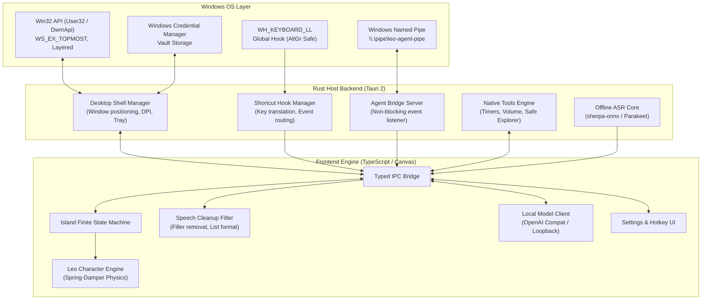

# System Architecture Document: Leo

**Document ID:** `ARCH-LEO-001`  
**Version:** `1.0.0` (Status: Approved)  
**Target Platform:** Windows 10 & 11 (64-bit AMD64)

---

## 1. High-Level System Architecture

Leo utilizes a hybrid **Tauri 2 (Rust) + TypeScript/Vite** architecture. Native operating system primitives (window transparency, low-level keyboard hooks, Win32 Named Pipes, and process spawning) reside in the Rust backend, while the user interface, animation physics, and local model streaming reside in the frontend webview.

---

## 2. Core Subsystems and Module Boundaries

### 2.1 `desktop-shell` (Rust)
- **Responsibility:** Manages the transparent Win32 window lifecycle, top-edge anchoring, multi-monitor topology changes, high-DPI coordinate scaling, and taskbar system tray integration.
- **Invariants:** Window never steals active focus when expanding or displaying notifications.

### 2.2 `companion-ui` (TypeScript & HTML5 Canvas)
- **Responsibility:** Renders the floating pill, collapsed state, expanded command card, chat thread, settings modal, and the original "Leo" animated character.
- **Invariants:** 60 FPS animation when active; zero CPU polling when asleep or minimized; full keyboard accessibility.

### 2.3 `voice` (Rust & TypeScript)
- **Responsibility:** Microphone audio acquisition, voice activity detection (VAD), offline ASR engine integration (`sherpa-onnx`), speech transcript cleanup filter, and Windows `SendInput` clipboard insertion.
- **Invariants:** Audio never leaves the local PC; prior clipboard state is restored within 150ms of text insertion.

### 2.4 `models` (TypeScript)
- **Responsibility:** Manages connections to local model servers (Ollama, LM Studio) and optional cloud APIs (Claude, OpenAI, Gemini).
- **Invariants:** Explicit visual disclosure (*"Leaves your PC"*) whenever an external cloud endpoint is invoked; streaming text parsing with cancellation.

### 2.5 `tools` (Rust)
- **Responsibility:** Typed allowlisted OS operations (timer, volume, date/time, File Explorer selection).
- **Invariants:** Zero execution of arbitrary shell strings (`cmd.exe /c`, `powershell.exe`); mandatory user confirmation for any action that modifies user state.

### 2.6 `agent-bridge` (Rust & TypeScript)
- **Responsibility:** Named pipe listener for coding agent session notifications (Claude Code, GitHub CLI).
- **Invariants:** Fail-open timeout guarantees; agent execution is never blocked if Leo is closed or unresponsive.
