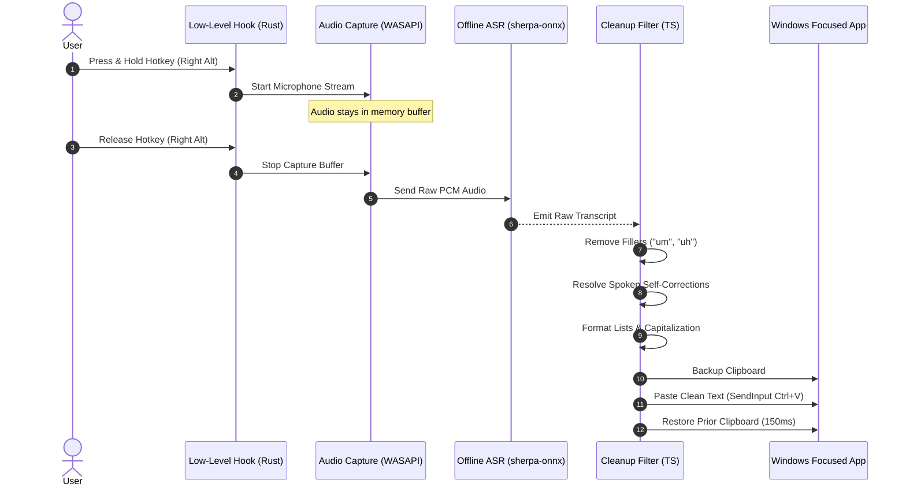
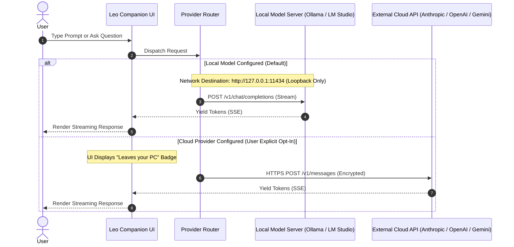
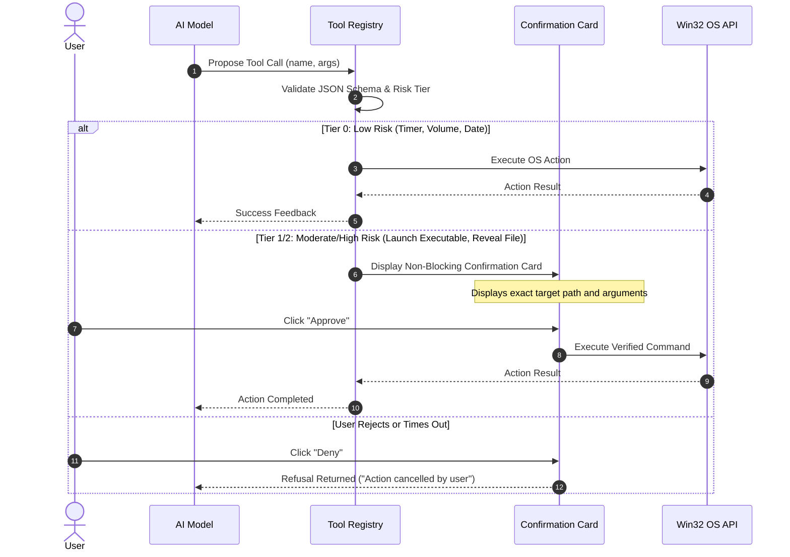

# Data Flow Architecture: Leo

**Document ID:** `FLOW-LEO-001`  
**Version:** `1.0.0` (Status: Approved)

---

## 1. Speech-to-Text & Universal Dictation Flow

The dictation pipeline operates entirely locally without sending audio to any network destination.

---

## 2. Local AI Chat vs Optional Cloud Provider Flow

Leo strictly isolates local loopback requests from external network traffic:

---

## 3. Safe OS Tool Calling & Confirmation Flow

